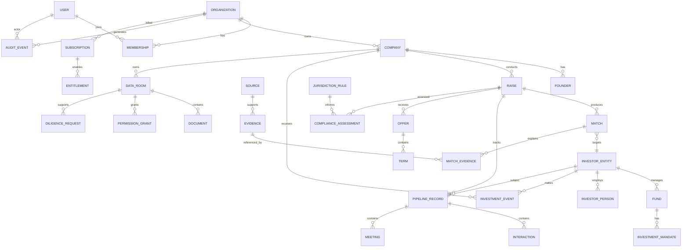

# ATLAS Database ERD — Conceptual V1

## Storage Rules

- `organization_id` tenant key appears on all tenant-owned records.
- Cross-tenant global intelligence entities are separate from private tenant records.
- Confidential founder data is never copied into global investor intelligence tables.
- Claims/evidence are append/supersede oriented; provenance is not destructively overwritten.
- Monetary values store currency + integer minor units/decimal-safe numeric values.
- Match results are immutable/versioned snapshots; recomputation creates a new version.
- Audit events are append-only at application level.
- Documents store metadata in Postgres and bytes in object storage.
- Embeddings reference source/document chunks and authorization scope; retrieval enforces permissions before generation.

## Index Priorities

- tenant + resource IDs
- raise pipeline state
- investor geography/stage/sector/check-range filters
- evidence/source freshness
- relationship graph endpoints
- vector semantic indexes for approved textual intelligence
- audit actor/resource/timestamp

Dedicated graph infrastructure is deferred until measured query complexity/latency justifies it.
